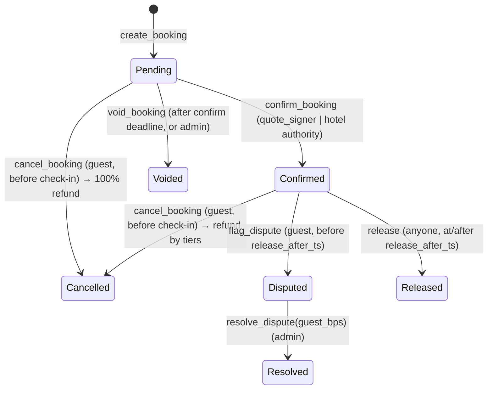

# Escrow Program Specification — `stumari_escrow`

Anchor 1.x program. This document is the contract: the Rust program, `packages/core` refund math and `spec/vectors/refund.json` must agree exactly.

## Constants

| Name | Value |
|---|---|
| `MAX_TIERS` | 8 |
| `BPS_DENOM` | 10_000 |
| `MAX_FEE_BPS` | 1_000 (10%) |
| Default `confirm_window_secs` | 7_200 (2h) |
| Default `release_delay_secs` | 86_400 (24h) — set small (e.g. 120) only on the demo config |

## Accounts

### `Config` — PDA `["config"]` (singleton)

| Field | Type | Notes |
|---|---|---|
| `admin` | Pubkey | arbiter stub; can register hotels, resolve disputes, void pending, update config |
| `quote_signer` | Pubkey | must co-sign `create_booking`; may `confirm_booking` |
| `mint` | Pubkey | the one accepted stablecoin (USDC on mainnet, mock USDC on devnet) |
| `treasury` | Pubkey | token account (mint = `mint`) that receives fees |
| `fee_bps` | u16 | ≤ `MAX_FEE_BPS`; charged on the hotel's gross share only |
| `confirm_window_secs` | u32 | |
| `release_delay_secs` | u32 | |
| `paused` | bool | blocks `create_booking` only (exits always work) |
| `bump` | u8 | |

### `Hotel` — PDA `["hotel", hotel_id]`

| Field | Type | Notes |
|---|---|---|
| `hotel_id` | [u8; 16] | UUID bytes of the hotel row in the DB |
| `authority` | Pubkey | hotel wallet; payouts go to its ATA for `config.mint`; may confirm bookings |
| `active` | bool | inactive hotels cannot receive new bookings |
| `bump` | u8 | |

### `Booking` — PDA `["booking", booking_id]`

| Field | Type | Notes |
|---|---|---|
| `booking_id` | [u8; 16] | random 16 bytes chosen by the server when building the payment tx |
| `hotel` | Pubkey | Hotel PDA |
| `guest` | Pubkey | token authority that paid; refunds go to the guest's ATA |
| `rent_payer` | Pubkey | who paid rent for booking + vault (the quote signer at creation); receives vault rent on close |
| `mint` | Pubkey | copy of config.mint at creation |
| `amount` | u64 | escrowed amount in mint base units (USDC: 6 decimals) |
| `fee_bps` | u16 | **snapshot** of `config.fee_bps` at creation — later config changes never affect an existing booking |
| `checkin_ts` | i64 | unix seconds of the hotel's check-in time on the check-in date |
| `checkout_ts` | i64 | > `checkin_ts` |
| `created_ts` | i64 | Clock at creation |
| `confirm_deadline_ts` | i64 | `created_ts + confirm_window_secs` |
| `release_after_ts` | i64 | `checkin_ts + release_delay_secs` |
| `quote_hash` | [u8; 32] | sha256 of the canonical signed quote bytes (see quote-protocol.md) |
| `option_index` | u8 | which option of the quote was bought |
| `tier_count` | u8 | 1..=8 |
| `tiers` | [Tier; 8] | `Tier { secs_before: u32, refund_bps: u16 }`; unused entries zeroed |
| `status` | u8 | `BookingStatus` |
| `refund_amount` | u64 | set on terminal transitions |
| `hotel_amount` | u64 | net paid to hotel |
| `fee_amount` | u64 | paid to treasury |
| `closed_ts` | i64 | 0 while open |
| `bump`, `vault_bump` | u8 | |

The `Booking` account is **never closed** — it is the public outcome label ("public labels" for model retraining). Only the vault is closed.

### Vault — PDA token account `["vault", booking]`

`token::mint = mint`, `token::authority = booking`. Created in `create_booking` (rent paid by the quote signer), closed on every terminal transition with rent returned to `booking.rent_payer`.

## Gasless guests

The guest never needs SOL. The operator key (= `quote_signer`) is the **transaction fee payer** for every guest-facing transaction and the **rent payer** for the booking and vault accounts. The guest signs only as the token authority (`create_booking`) or as the booking owner (`cancel_booking`, `flag_dispute`). The server builds each transaction, partially signs it as fee payer (and as quote signer where required), and the guest's wallet adds its signature. Vault rent is recovered on close; the `Booking` account (~0.003 SOL) persists as the public record.

## Status machine



`BookingStatus` codes: `Pending=0, Confirmed=1, Cancelled=2, Released=3, Disputed=4, Resolved=5, Voided=6`.

No-show is not a separate instruction: a guest who does not arrive and does not dispute is released to the hotel (a no-show refund of 0% is the norm, and every template's last tier ends at check-in). The guest's recourse is `flag_dispute` inside the 24h window.

## Tier semantics (shared with TS)

- `tiers` sorted by `secs_before` **strictly descending**; the **last tier has `secs_before == 0`**; every `refund_bps ≤ 10_000`; `1 ≤ tier_count ≤ 8`.
- For a cancellation at time `now` with `secs_before = checkin_ts − now` (always ≥ 1 because cancel requires `now < checkin_ts`), the refund bps is the `refund_bps` of the **first** tier with `secs_before ≥ tier.secs_before`.

```
refund_bps(tiers, secs_before) = first t in tiers where secs_before >= t.secs_before → t.refund_bps
```

## Money math (all u128 intermediates, floor division, checked)

```
refund      = amount * refund_bps / 10_000
hotel_gross = amount - refund
fee         = hotel_gross * fee_bps / 10_000
hotel_net   = hotel_gross - fee
invariant: refund + hotel_net + fee == amount
```

Rounding dust therefore goes to the hotel. Zero-value transfers are skipped.

## Instructions

### `initialize_config(quote_signer, fee_bps, confirm_window_secs, release_delay_secs)`
Signer: `admin` (payer). Accounts: `config` (init), `mint`, `treasury` (token account, mint == `mint`). Sets `admin = signer`, `paused = false`. Errors: `FeeTooHigh`, `InvalidTreasury`.

### `update_config(UpdateConfigArgs { admin?, quote_signer?, treasury?, fee_bps?, confirm_window_secs?, release_delay_secs?, paused? })`
Signer: `config.admin`. `treasury` if provided must be a token account of `config.mint`. `mint` is immutable.

### `register_hotel(hotel_id: [u8;16], authority: Pubkey)`
Signer: `config.admin` (payer). Creates `Hotel` with `active = true`. The off-chain registration flow also creates the authority's ATA idempotently so payouts never fail on a missing account.

### `update_hotel(authority?: Pubkey, active?: bool)`
Signer: `config.admin`.

### `create_booking(CreateBookingArgs)`
```
CreateBookingArgs {
  booking_id: [u8;16], amount: u64, checkin_ts: i64, checkout_ts: i64,
  quote_hash: [u8;32], option_index: u8, tiers: Vec<Tier>, quote_expires_ts: i64
}
```
Signers: `quote_signer` (mut; must equal `config.quote_signer`; pays rent for `booking` and `vault`), `guest` (token authority of `guest_token_account`).
Accounts: `config`, `hotel`, `mint` (== config.mint), `guest_token_account` (mut; mint, authority = guest), `booking` (init, payer = quote_signer), `vault` (init, payer = quote_signer), token program, system program.
Checks, in order: `!paused` (`Paused`); `hotel.active` (`HotelInactive`); `now ≤ quote_expires_ts` (`QuoteExpired`); `now < checkin_ts < checkout_ts` (`InvalidTimes`); `amount > 0` (`InvalidAmount`); tier rules (`InvalidTiers`).
Effects: `transfer_checked(amount)` guest → vault; populate fields (`rent_payer = quote_signer`, `fee_bps = config.fee_bps`); `status = Pending`; emit `BookingCreated`.

Because the quote signer co-signs the whole transaction, every argument (price, tiers, times, quote hash) is authenticated by Stumari — the guest cannot alter the terms (ADR-0004).

### `confirm_booking()`
Signer: `config.quote_signer` **or** `hotel.authority` (else `Unauthorized`). Requires `Pending` (`InvalidStatus`). → `Confirmed`. Emit `BookingConfirmed`.

### `cancel_booking()`
Signer: `booking.guest` (`Unauthorized`). Requires `Pending | Confirmed` (`InvalidStatus`) and `now < checkin_ts` (`TooLateToCancel`).
`refund_bps = 10_000` if `Pending`, else tier lookup. Transfers refund → guest ATA, hotel_net → hotel authority ATA, fee → treasury; close vault → `rent_payer`. `status = Cancelled`, store amounts, `closed_ts = now`. Emit `BookingCancelled { secs_before, refund_bps, refund, hotel_amount, fee }`.

### `release()`
No signer required (permissionless crank; the transaction fee payer pays). Requires `Confirmed` (`InvalidStatus`) and `now ≥ release_after_ts` (`NotReleasable`). `refund = 0`; hotel_net + fee transfers; close vault → `rent_payer`. `status = Released`. Emit `BookingReleased`.

### `flag_dispute()`
Signer: `booking.guest`. Requires `Confirmed` and `now < release_after_ts` (`DisputeWindowClosed`). → `Disputed`. Emit `BookingDisputed`.

### `resolve_dispute(guest_bps: u16)`
Signer: `config.admin`. Requires `Disputed`; `guest_bps ≤ 10_000` (`InvalidBps`). `refund = amount * guest_bps / 10_000`; remainder → hotel minus fee; close vault → `rent_payer`. → `Resolved`. Emit `DisputeResolved`.

### `void_booking()`
Signer: `authority` (any signer). Requires `Pending`, and (`now ≥ confirm_deadline_ts` **or** `authority == config.admin`) (`VoidTooEarly`). Full refund; close vault → `rent_payer`. → `Voided`. Emit `BookingVoided { by_admin }`.

## Account constraints common to payout instructions

`config` (seeds), `hotel` (== `booking.hotel`), `mint` (== `booking.mint`), `vault` (seeds, mut), `guest_token_account` = ATA(mint, `booking.guest`) (mut), `hotel_token_account` = ATA(mint, `hotel.authority`) (mut), `treasury` (== `config.treasury`, mut), `rent_payer` system account (mut, == `booking.rent_payer`, receives vault rent). Fees are computed with `booking.fee_bps`, never `config.fee_bps`. Clients should prepend an idempotent ATA-create instruction (fee payer = operator) for the guest ATA on cancel/void/resolve in case it was closed.

## Trust property

Escrowed funds can only ever move to **the guest's ATA, the hotel authority's ATA, or the treasury** — and the treasury share is bounded by the booking's own `fee_bps` snapshot (≤ 10%). No Stumari key can redirect escrow to any other account. The admin key's power is limited to choosing the guest/hotel split of a *disputed* booking and voiding *unconfirmed* bookings (which can only refund the guest).

## Errors

`Paused, HotelInactive, QuoteExpired, InvalidTimes, InvalidAmount, InvalidTiers, InvalidStatus, TooLateToCancel, NotReleasable, DisputeWindowClosed, VoidTooEarly, Unauthorized, InvalidBps, FeeTooHigh, InvalidMint, InvalidTreasury, MathOverflow`

## Events

`BookingCreated { booking, booking_id, hotel, guest, amount, checkin_ts, checkout_ts, option_index, quote_hash }`,
`BookingConfirmed { booking, by }`,
`BookingCancelled { booking, secs_before, refund_bps, refund, hotel_amount, fee }`,
`BookingReleased { booking, hotel_amount, fee }`,
`BookingDisputed { booking }`,
`DisputeResolved { booking, guest_bps, refund, hotel_amount, fee }`,
`BookingVoided { booking, by_admin }`.

## Test plan (must pass before devnet deploy)

Pure logic (`cargo test`, and the same vectors in TS): every case in `spec/vectors/refund.json`, tier validation cases.
Integration (LiteSVM, with Clock warps): happy path create→confirm→release; cancel at each tier boundary (exactly at threshold, one second either side); cancel while Pending = 100%; cancel at/after check-in fails; void before deadline fails, after deadline succeeds, admin void anytime; dispute window; resolve split + fee; wrong quote signer fails; paused blocks create but not cancel; inactive hotel; fee invariant `refund + hotel_net + fee == amount`; vault closed and rent returned to `rent_payer`; booking account persists; `fee_bps` snapshot used even after `update_config` changes the fee; gasless: operator is fee payer and rent payer, guest signs only as token authority or booking owner.
