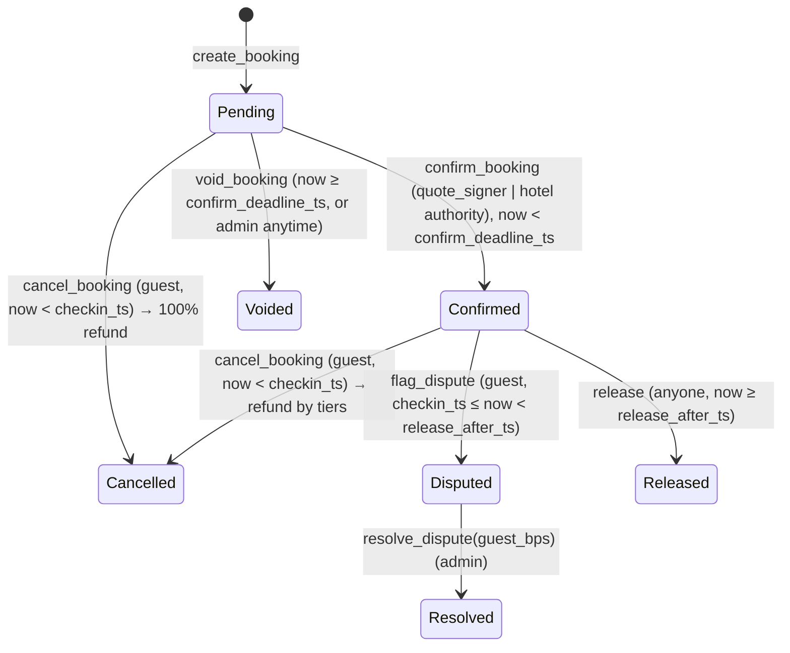

# Escrow Program Specification — `stumari_escrow`

Anchor **1.1.2** program. This document is the contract: the Rust program, `packages/core` refund math and `spec/vectors/refund.json` must agree exactly. Program id: `6Y17gFD9dWPJF6GtpzABJZY7Pk8j5CLh268zZyW5U6nf` (also in `onchain/artifacts/program-id.txt`).

## Crate setup

`anchor-lang = "=1.1.2"`, `anchor-spl = { version = "=1.1.2", default-features = false, features = ["token", "token_2022", "associated_token"] }` (`token_2022` is required for Anchor 1.1.2's `init` + `token::` codegen even though only classic SPL Token is accepted), `[features] idl-build = ["anchor-lang/idl-build", "anchor-spl/idl-build"]`. Keep every `anchor-*` crate on the same exact version (if `=1.1.2` cannot resolve, use `=1.2.0` for all and record it in CLAUDE.md). Commit `onchain/Cargo.lock`.

**Token program: classic SPL Token only** (USDC mainnet and the devnet mock mint are classic). Use `Program<'info, Token>`, `Account<'info, Mint>`, `Account<'info, TokenAccount>`. CPIs: `token::transfer_checked` and `token::close_account` via `CpiContext::new_with_signer(Token::id(), …, &[&[b"booking", booking.booking_id.as_ref(), &[booking.bump]]])`. Never use the `close =` constraint on the vault.

## Constants

| Name | Value |
|---|---|
| `MAX_TIERS` | 8 |
| `BPS_DENOM` | 10_000 |
| `MAX_FEE_BPS` | 1_000 (10%) |
| `MIN_WINDOW_SECS` | 60 (lower bound for `confirm_window_secs` and `release_delay_secs`) |
| Default `confirm_window_secs` | 7_200 (2h) |
| Default `release_delay_secs` | 86_400 (24h) — 120 only on the devnet demo config |

**Devnet release demo:** `create_booking` requires `now < checkin_ts`, so on real time a release is only demonstrable for a same-day booking made before the hotel's check-in time. The quote API allows `checkin_date = today` while `now < checkin_ts`; for a live demo the admin can set the demo hotel's `checkin_time` to a few minutes from now. With `release_delay_secs = 120`, release is crankable 2 minutes after check-in. Time-travel demos use Surfpool.

## Accounts

### `Config` — PDA `["config"]` (singleton)

| Field | Type | Notes |
|---|---|---|
| `admin` | Pubkey | arbiter stub; registers hotels, resolves disputes, voids pending, updates config |
| `quote_signer` | Pubkey | must co-sign `create_booking`; may `confirm_booking`; pays rent (gasless design) |
| `mint` | Pubkey | the one accepted stablecoin (immutable) |
| `treasury` | Pubkey | token account (mint = `mint`) receiving fees and swept vault excess |
| `fee_bps` | u16 | ≤ `MAX_FEE_BPS`; applies to **new** bookings only (snapshotted) |
| `confirm_window_secs` | u32 | ≥ `MIN_WINDOW_SECS` |
| `release_delay_secs` | u32 | ≥ `MIN_WINDOW_SECS` |
| `paused` | bool | blocks `create_booking` only (exits always work) |
| `bump` | u8 | |

### `Hotel` — PDA `["hotel", hotel_id]`

| Field | Type | Notes |
|---|---|---|
| `hotel_id` | [u8; 16] | bytes of the DB hotel UUID (see data-model.md "ID encoding") |
| `authority` | Pubkey | hotel wallet; may confirm bookings; **new** bookings snapshot it as their payout owner |
| `active` | bool | inactive hotels cannot receive new bookings |
| `bump` | u8 | |

### `Booking` — PDA `["booking", booking_id]`

| Field | Type | Notes |
|---|---|---|
| `booking_id` | [u8; 16] | **derived from the quote id** by the server: `sha256("stumari-booking-v1" ‖ quote.id as UTF-8)[0..16]` — one booking per quote, enforced by `init` |
| `hotel` | Pubkey | Hotel PDA |
| `hotel_authority` | Pubkey | **snapshot** of `hotel.authority` at creation — payouts always go to ATA(mint, `hotel_authority`) |
| `guest` | Pubkey | token authority that paid; refunds go to ATA(mint, `guest`) |
| `rent_payer` | Pubkey | the quote signer at creation (paid booking + vault rent); receives vault rent on close |
| `mint` | Pubkey | copy of `config.mint` |
| `amount` | u64 | escrowed amount in base units (USDC: 6 decimals) |
| `fee_bps` | u16 | **snapshot** of `config.fee_bps` |
| `checkin_ts` | i64 | unix seconds of the hotel's check-in time on the check-in date |
| `checkout_ts` | i64 | > `checkin_ts` |
| `created_ts` | i64 | Clock at creation |
| `confirm_deadline_ts` | i64 | `created_ts + confirm_window_secs` |
| `release_after_ts` | i64 | `checkin_ts + release_delay_secs` |
| `quote_hash` | [u8; 32] | sha256 of the canonical quote bytes (quote-protocol.md) |
| `option_index` | u8 | which quote option was bought |
| `tier_count` | u8 | 1..=8 |
| `tiers` | [Tier; 8] | `Tier { secs_before: u32, refund_bps: u16 }` (derive `InitSpace, Clone, Copy, Default`); unused entries zeroed |
| `status` | u8 | `BookingStatus` |
| `refund_amount`, `hotel_amount`, `fee_amount` | u64 | set on terminal transitions |
| `closed_ts` | i64 | 0 while open |
| `bump`, `vault_bump` | u8 | |

The `Booking` account is **never closed** — it is the durable public outcome label. Only the vault is closed. (351 bytes incl. discriminator, rent ≈ 0.00334 SOL, paid by the operator — an accepted per-booking cost.)

### Vault — PDA token account `["vault", booking]`

`token::mint = mint`, `token::authority = booking`. Created in `create_booking` (rent paid by `quote_signer`), closed on every terminal transition with rent to `booking.rent_payer`.

## Gasless guests

The guest never needs SOL. The operator key (= `quote_signer`) is the **transaction fee payer** for every guest-facing transaction and the **rent payer** for booking + vault. The guest signs only as token authority (`create_booking`) or booking owner (`cancel_booking`, `flag_dispute`). The server builds each transaction, partially signs as fee payer (and quote signer where required), and the wallet adds its signature. Operator-cost abuse is mitigated off-chain (security.md).

## Status machine



`BookingStatus`: `Pending=0, Confirmed=1, Cancelled=2, Released=3, Disputed=4, Resolved=5, Voided=6`.

By clock, **cancel** (`now < checkin_ts`), **dispute** (`checkin_ts ≤ now < release_after_ts`) and **release** (`now ≥ release_after_ts`) never overlap; **confirm** (`now < confirm_deadline_ts`) and permissionless **void** (`now ≥ confirm_deadline_ts`) never overlap.

No-show has no instruction: a guest who does not arrive and does not dispute is released to the hotel. The guest's recourse is `flag_dispute` inside the window after check-in.

## Tier semantics (shared with TS)

- `tiers` sorted by `secs_before` **strictly descending**; the **last tier has `secs_before == 0`**; each `refund_bps ≤ 10_000`; `1 ≤ tier_count ≤ 8`.
- `secs_before = checkin_ts − now` as **i64** (≥ 1 because cancel requires `now < checkin_ts`). Compare as i64 — `secs_before >= t.secs_before as i64`; never cast `secs_before` down to u32.

```
refund_bps(tiers, secs_before) = first t in tiers where secs_before >= t.secs_before → t.refund_bps
```

## Money math (u128 intermediates, floor division, checked)

```
refund      = amount * refund_bps / 10_000
hotel_gross = amount - refund
fee         = hotel_gross * fee_bps / 10_000        (booking.fee_bps)
hotel_net   = hotel_gross - fee
invariant: refund + hotel_net + fee == amount
```

Rounding dust goes to the hotel. Zero-value transfers are skipped.

**Vault excess sweep:** anyone can send tokens to a vault (it is a public PDA). Every exit pays out exactly `booking.amount` as above, then reloads the vault; if `vault.amount > 0`, it transfers that excess to `config.treasury` before `close_account`. The excess is reported as `excess` in the event. Without this, a 1-unit donation would make `close_account` fail and lock the booking forever.

## Instructions and accounts

Common: `booking` is `mut, seeds = [b"booking", booking.booking_id.as_ref()], bump = booking.bump`; `config` has seeds `[b"config"]`; `mint` must equal `booking.mint`; `vault` has seeds `[b"vault", booking.key().as_ref()]`, `mut`; `guest_token_account` = ATA(mint, `booking.guest`); `hotel_token_account` = ATA(mint, `booking.hotel_authority`); `treasury` must equal `config.treasury` **and differ from `vault`** (`InvalidTreasury` — an admin setting a booking's vault as treasury would otherwise block that booking's close); `rent_payer` (`SystemAccount`, `mut`) must equal `booking.rent_payer`; `token_program: Program<'info, Token>`.

`guest_token_account`, `hotel_token_account` and `treasury` are declared **`#[account(mut, dup, …)]`** — Anchor 1.x rejects duplicate mutable accounts by default, and they legitimately alias when one wallet is both guest and hotel (founder demos) or owns the treasury. The handler never reads their balances, so aliasing is safe. Signer/SystemAccount overlaps (`quote_signer == admin == rent_payer == fee payer`) are not subject to the check.

The server/cron prepends an idempotent `CreateAssociatedTokenAccount` (fee payer = operator) for every recipient ATA an instruction takes.

### `initialize_config(quote_signer: Pubkey, fee_bps: u16, confirm_window_secs: u32, release_delay_secs: u32)`
Accounts: `admin` (Signer, mut, payer), `config` (init), `mint`, `treasury` (token account of `mint`), `program: Program<'info, StumariEscrow>` with `program.programdata_address()? == Some(program_data.key())`, `program_data: Account<'info, ProgramData>` with `upgrade_authority_address == Some(admin.key())` (`Unauthorized`) — only the upgrade authority can initialize (no front-running), system program.
Validation: `fee_bps ≤ MAX_FEE_BPS` (`FeeTooHigh`), `treasury.mint == mint` (`InvalidTreasury`), both windows ≥ `MIN_WINDOW_SECS` (`InvalidTimes`). Sets `admin = signer`, `paused = false`.

### `update_config(UpdateConfigArgs { admin: Option<Pubkey>, quote_signer: Option<Pubkey>, fee_bps: Option<u16>, confirm_window_secs: Option<u32>, release_delay_secs: Option<u32>, paused: Option<bool> })`
Accounts: `admin` (Signer, == `config.admin`), `config` (mut), optional `treasury` (`Option<Account<TokenAccount>>`; if present, mint must equal `config.mint`, sets `config.treasury`). Same validation as `initialize_config`. `mint` is immutable. Changes never affect existing bookings.

### `register_hotel(hotel_id: [u8;16], authority: Pubkey)`
Accounts: `admin` (Signer, mut, payer, == `config.admin`), `config`, `hotel` (init, seeds `["hotel", hotel_id]`), system program. `active = true`. The off-chain registration flow creates the authority's ATA idempotently.

### `update_hotel(authority: Option<Pubkey>, active: Option<bool>)`
Accounts: `admin` (Signer, == `config.admin`), `config`, `hotel` (mut). Changing `authority` affects **only bookings created afterwards** (existing bookings keep their `hotel_authority` snapshot).

### `create_booking(CreateBookingArgs)`
```
CreateBookingArgs {
  booking_id: [u8;16], amount: u64, checkin_ts: i64, checkout_ts: i64,
  quote_hash: [u8;32], option_index: u8, tiers: Vec<Tier>, quote_expires_ts: i64
}
```
Accounts: `quote_signer` (Signer, mut, == `config.quote_signer`, payer of both inits), `guest` (Signer), `config`, `hotel` (seeds `["hotel", hotel.hotel_id]`), `mint` (== `config.mint`), `guest_token_account` (mut; `token::mint = mint, token::authority = guest`), `booking` (init, seeds `["booking", args.booking_id]`), `vault` (init, token account PDA), `token_program`, `system_program`.
Checks, in order: `!paused` (`Paused`); `hotel.active` (`HotelInactive`); `now ≤ quote_expires_ts` (`QuoteExpired`); `now < checkin_ts < checkout_ts` (`InvalidTimes`); `amount > 0` (`InvalidAmount`); tier rules (`InvalidTiers`).
Effects: `transfer_checked(amount)` guest ATA → vault; populate fields (`hotel_authority = hotel.authority`, `rent_payer = quote_signer`, `fee_bps = config.fee_bps`, deadlines with checked i64 math); `status = Pending`; emit `BookingCreated`.

Because the quote signer co-signs the whole message, every argument and every account is fixed by Stumari — the guest cannot alter terms (ADR-0004).

### `confirm_booking()`
Accounts: `authority` (Signer; must be `config.quote_signer` or `hotel.authority`, else `Unauthorized`), `config`, `hotel` (== `booking.hotel`), `booking` (mut). Requires `Pending` (`InvalidStatus`) and `now < confirm_deadline_ts` (`ConfirmWindowClosed`). → `Confirmed`. Emit `BookingConfirmed`.

### `cancel_booking(min_refund: u64)`
Accounts: `guest` (Signer, == `booking.guest`, else `Unauthorized`), `booking`, `config`, `mint`, `vault`, `guest_token_account`, `hotel_token_account`, `treasury`, `rent_payer`, `token_program`.
Requires `Pending | Confirmed` (`InvalidStatus`) and `now < checkin_ts` (`TooLateToCancel`). `refund_bps = 10_000` if `Pending`, else tier lookup. Requires `refund ≥ min_refund` (`RefundBelowMinimum`) — protects the guest against a confirm or a tier boundary landing between building and sending. Transfers refund → guest ATA, hotel_net → hotel ATA, fee → treasury; sweep excess; close vault → `rent_payer`. `status = Cancelled`, store amounts, `closed_ts = now`. Emit `BookingCancelled`.

The server sets `min_refund` to the refund the guest was shown, computed with the booking's **tier schedule at now + 90 s** (never the Pending 100% unless the UI explicitly showed Pending terms).

### `release()`
Accounts: `booking`, `config`, `mint`, `vault`, `hotel_token_account`, `treasury`, `rent_payer`, `token_program`. **No signer** (permissionless crank; fee payer pays). No guest ATA — release must work even if the guest closed theirs.
Requires `Confirmed` (`InvalidStatus`) and `now ≥ release_after_ts` (`NotReleasable`). hotel_net + fee; sweep; close. → `Released`. Emit `BookingReleased`.

### `flag_dispute()`
Accounts: `guest` (Signer, == `booking.guest`), `booking` (mut). Requires `Confirmed` (`InvalidStatus`) and `checkin_ts ≤ now < release_after_ts` (`DisputeWindowClosed`). → `Disputed`. Emit `BookingDisputed`.

### `resolve_dispute(guest_bps: u16)`
Accounts: `admin` (Signer, == `config.admin`), `booking`, `config`, `mint`, `vault`, `guest_token_account`, `hotel_token_account`, `treasury`, `rent_payer`, `token_program`. Requires `Disputed`; `guest_bps ≤ 10_000` (`InvalidBps`). refund = `amount * guest_bps / 10_000`; remainder → hotel minus fee; sweep; close. → `Resolved`. Emit `DisputeResolved`.

### `void_booking()`
Accounts: `authority` (Signer, any), `booking`, `config`, `mint`, `vault`, `guest_token_account`, `treasury` (only for the excess sweep), `rent_payer`, `token_program`. No hotel ATA.
Requires `Pending`, and (`now ≥ confirm_deadline_ts` **or** `authority == config.admin`) (`VoidTooEarly`). Full refund; sweep; close. → `Voided`. Emit `BookingVoided`.

## Trust property

Escrowed funds can only ever move to **ATA(mint, `booking.guest`)**, **ATA(mint, `booking.hotel_authority`)**, or the **treasury** — and the treasury share is bounded by the booking's own `fee_bps` snapshot (≤ 10%). Both recipient owners are fixed at creation, so no Stumari key can redirect escrow afterwards **under this program** — during the pilot the program itself is upgradeable by Stumari, and disputed funds depend on the arbiter key (security.md, "Honest limits"). The admin key can only choose the guest/hotel split of a **disputed** booking and void **unconfirmed** bookings (refund only). Tokens sent directly to a vault outside `create_booking` are swept to the treasury on close.

## Errors

`rent_payer ≠ booking.rent_payer` and a `confirm_booking` hotel ≠ `booking.hotel` return `Unauthorized`; a recipient that is not the snapshot owner's ATA fails Anchor's `ConstraintTokenOwner` / `ConstraintAssociated`. `MAX_TIERS` is a plain Rust const (the IDL carries it as the `tiers` array length). Logic tests read the vectors via `scripts/program.sh`, which copies `spec/vectors` next to the workspace.


`Paused, HotelInactive, QuoteExpired, InvalidTimes, InvalidAmount, InvalidTiers, InvalidStatus, TooLateToCancel, RefundBelowMinimum, NotReleasable, DisputeWindowClosed, ConfirmWindowClosed, VoidTooEarly, Unauthorized, InvalidBps, FeeTooHigh, InvalidMint, InvalidTreasury, MathOverflow`

## Events (`emit!`, log-based; the Booking account is the durable label)

- `BookingCreated { booking, booking_id: [u8;16], hotel, hotel_authority, guest, amount: u64, checkin_ts: i64, checkout_ts: i64, option_index: u8, quote_hash: [u8;32], fee_bps: u16 }`
- `BookingConfirmed { booking, by: Pubkey }`
- `BookingCancelled { booking, secs_before: i64, refund_bps: u16, refund: u64, hotel_amount: u64, fee: u64, excess: u64 }`
- `BookingReleased { booking, hotel_authority, hotel_amount: u64, fee: u64, excess: u64 }`
- `BookingDisputed { booking }`
- `DisputeResolved { booking, guest_bps: u16, refund: u64, hotel_amount: u64, fee: u64, excess: u64 }`
- `BookingVoided { booking, by_admin: bool, refund: u64, excess: u64 }` — `by_admin` is `authority == config.admin`; in the devnet topology (admin = operator) the cron's post-deadline voids also report `true`, so indexers distinguish an admin override by `closed_ts < confirm_deadline_ts`

## Test plan (all must pass before devnet deploy)

**Pure logic** (`src/logic.rs`, `cargo test`; the same vectors in TS): every case in `spec/vectors/refund.json` — cancel (incl. errors), release, resolve, tier validation. Read the JSON at runtime from `concat!(env!("CARGO_MANIFEST_DIR"), "/../../spec/vectors/refund.json")`.

**LiteSVM setup:** `LiteSVM::new()` (bundles SPL Token and ATA — verify); dev-deps compatible with the solana 3.x crates (e.g. `spl-token-interface`, `spl-associated-token-account-interface`) for `initialize_mint2`, ATA creation and `mint_to`; 6-decimal mint; set the Clock before every time-dependent step (`let mut c: Clock = svm.get_sysvar(); c.unix_timestamp = T; svm.set_sysvar(&c);`) and call `svm.expire_blockhash()` before resending an identical transaction. Deploy the program with an upgrade authority so `initialize_config` can be tested (or set the ProgramData account directly).

**Positive:** config init by upgrade authority; register hotel; create (gasless: operator = fee payer + quote signer + rent payer, guest signs only as token authority) → confirm → release after `release_after_ts`; cancel at each tier boundary (exactly at threshold, and one second either side); cancel while Pending = 100%; void after deadline (anyone) and admin void before deadline; dispute at `checkin_ts` then resolve with an odd split + fee; fee snapshot survives `update_config(fee_bps)`; `update_hotel(authority = X)` after create — release still pays the snapshot authority; donation of 1 unit to a vault, then every exit succeeds and the vault is closed with excess to treasury; guest == hotel authority and treasury owned by the guest (dup) — cancel and release succeed and the invariant holds; vault rent returned to `rent_payer`; booking account persists with final amounts.

**Negative (each must fail):** init config by a non-upgrade-authority; create without the quote signer or with a wrong quote signer; create when paused (while cancel of an existing booking still works); inactive hotel; expired quote; bad times; zero amount; invalid tiers; second create with the same booking_id; confirm by a random signer; confirm at `confirm_deadline_ts`; void by non-admin before the deadline; cancel by non-guest; cancel at/after check-in; cancel with `min_refund` above the actual refund; dispute at `checkin_ts − 1` and at `release_after_ts`; release before `release_after_ts`; double release; resolve by non-admin; `guest_bps > 10000`; `update_config(fee_bps = 1001)`; substitution attacks — another booking's vault, a guest ATA of a different owner, a hotel ATA of a non-snapshot authority, treasury ≠ config, rent_payer ≠ booking, mint ≠ booking, a Hotel account passed as Booking. Assert error codes where the check runs before vault deserialization; otherwise assert only failure.
