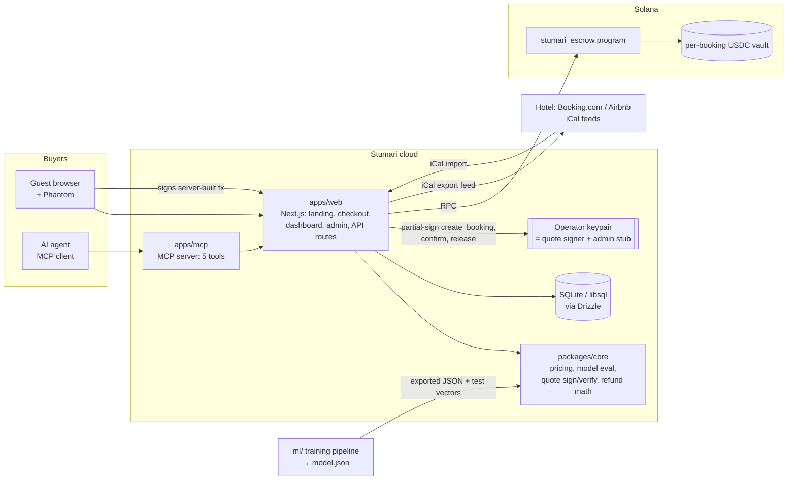

# Architecture Overview

## Components



| Component | Path | Language | Responsibility |
|---|---|---|---|
| Escrow program | `onchain/programs/stumari_escrow` | Rust (Anchor 1.x) | Holds USDC per booking, enforces refund tiers, confirm/void, dispute, release. Spec: [escrow-program.md](escrow-program.md) |
| Escrow client | `packages/escrow-client` | TypeScript | Codama-generated `@solana/kit` client from the Anchor IDL, PDA helpers, transaction builders used by the server |
| Core library | `packages/core` | TypeScript | Refund math (mirrors program), pricing engine, model evaluator, feature adapter, quote canonicalization + Ed25519 signing. Spec: [quote-protocol.md](quote-protocol.md), [pricing-and-risk-model.md](pricing-and-risk-model.md) |
| ML pipeline | `ml/` | Python | Train discrete-time hazard GBDT on Hotel Booking Demand, calibrate, evaluate, export `model.json` + parity vectors |
| Web app | `apps/web` | Next.js (App Router), Tailwind | Landing (EN/KA/RU) + apply, hotel checkout, booking page, hotel dashboard, admin, REST API, iCal import/export, cron endpoints. Specs: [api.md](api.md), [data-model.md](data-model.md), [inventory-ical.md](inventory-ical.md) |
| MCP server | `apps/mcp` | TypeScript | Five tools over the public REST API |
| Scripts | `scripts/` | TypeScript | Devnet bootstrap (mock USDC mint, config, demo hotel), E2E loop |
| Shared fixtures | `spec/vectors` | JSON | Refund vectors used by both Rust and TS tests |

## Keys and trust

| Key | Held by | Powers |
|---|---|---|
| **Operator key** (`OPERATOR_SECRET_KEY`) | web server | Co-signs `create_booking` (proves terms came from Stumari's quote), `confirm_booking`, pays fees for `release` crank. On devnet it is also the **admin** (arbiter stub). |
| **Admin key** | web server (MVP) | `initialize_config`, `register_hotel`, `resolve_dispute`, admin `void`. Disclosed stub → Squads multisig later. |
| **Hotel authority** | hotel's Phantom | Receives payouts (its USDC ATA). Signs in to the dashboard (SIWS). |
| **Guest wallet** | guest's Phantom / agent wallet / devnet demo wallet | Signs as token authority (pays USDC), cancels, flags disputes. Needs **no SOL** — the operator is fee payer (ADR-0009). |

See [security.md](security.md) for the threat model.

## Flow 1 — Quote and pay

```mermaid
sequenceDiagram
  participant G as Guest (browser)
  participant W as web API
  participant C as core
  participant DB
  participant S as Solana
  G->>W: POST /api/quotes {hotel, roomType, dates, guests}
  W->>DB: availability (iCal blocks, bookings, holds)
  W->>C: features → hazard → price menu
  C-->>W: options [{flexible, price, tiers}, …]
  W->>DB: insert quote + 10-min hold on a unit
  W-->>G: signed quote (Ed25519)
  G->>W: POST /api/quotes/{id}/pay {optionId, payer}
  W->>W: re-check hold/expiry, fresh iCal sync of the unit
  W->>W: build v0 tx create_booking(args…), fee payer = operator
  W->>W: partial-sign as fee payer + quote_signer
  W-->>G: base64 tx + bookingId
  G->>G: wallet signs (solana:signTransaction)
  G->>W: POST /api/tx/send {signed tx}
  W->>S: relay; wait for confirmation
  W->>S: verify booking account == expected
  W->>DB: status = pending
  W->>W: fresh iCal import; no conflict?
  W->>S: confirm_booking (operator signs)
  W->>DB: status = confirmed
```

## Flow 2 — Cancel

The server builds a `cancel_booking` transaction (operator = fee payer) and the guest's wallet signs it as booking owner; the browser posts it to `/api/tx/send`. The program reads the Clock, finds the tier, and transfers refund → guest and remainder (minus fee) → hotel in the same instruction. The web app observes the signature and updates the DB; the booking disappears from the iCal export feed.

## Flow 3 — Release / dispute / void

- `release`: permissionless after `release_after_ts = checkin_ts + release_delay` if `Confirmed`. Cron (`/api/cron/release`) cranks it with the operator key paying the fee.
- `flag_dispute`: guest, while `Confirmed`, before `release_after_ts` → `Disputed`. Admin resolves with `guest_bps`.
- `void_unconfirmed`: if still `Pending` after `confirm_deadline_ts` (created + 2h), anyone may void → full refund. Admin may void a `Pending` booking at any time (e.g. double-booking detected).

## Environments

| Env | Chain | DB | Notes |
|---|---|---|---|
| local | Surfpool / solana-test-validator (WSL) or devnet | `file:./.data/stumari.db` | E2E with time travel on Surfpool |
| demo | devnet | local file or Turso | mock USDC mint we control ("USDC-dev") |
| pilot | mainnet-beta | Turso | real USDC `EPjFWdd5AufqSSqeM2qN1xzybapC8G4wEGGkZwyTDt1v`; only after review — see security.md |

## Repository layout

```
docs/            specs, ADRs, plan, sales and submission kits  ← read first
spec/vectors/    shared test fixtures (Rust + TS)
onchain/         Anchor workspace (programs/stumari_escrow)
packages/core/   shared TS domain logic (no Solana deps): refund math, pricing, model eval, quotes
packages/escrow-client/  Codama-generated Kit client for stumari_escrow + PDA helpers
apps/web/        Next.js app (landing, checkout, dashboard, admin, API)
apps/mcp/        MCP server
ml/              Python training pipeline + exported model artifacts
scripts/         devnet bootstrap, E2E, program build helper (WSL)
```
